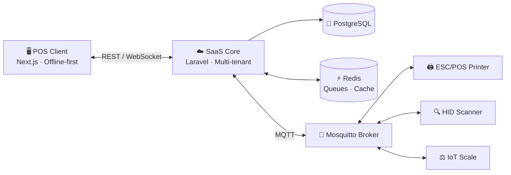

<!-- ============================== HEADER ============================== -->

 

---

## 👋 About Me

I bridge the gap between **complex cloud logic** and **real-world hardware**. I design and ship SaaS platforms that keep working when the network doesn't, and talk to printers, scanners and scales in real time.

<table>
<tr>
<td width="50%" valign="top">

### 🏗️ What I build
- 🛒 **POS SaaS**: multi-tenant architectures with offline-first sync for retail
- 📡 **Real-time IoT**: MQTT between SaaS backends and on-site hardware
- 🕷️ **Data extraction**: distributed, resilient scraping engines with anti-bot handling
- ⚙️ **Reliability**: Docker orchestration and Nginx reverse proxies built for high uptime

</td>
<td width="50%" valign="top">

### 🎯 Principles
- 🔌 **Offline-first**: a shop never stops selling
- ⚡ **Low latency**: hardware events in milliseconds
- 🔐 **Secure by default**: tenant isolation, audited code paths
- 🧪 **Tested**: Pest (PHP) and Playwright (E2E)

</td>
</tr>
</table>

---

## 🧭 Architecture at a Glance

---

## 🛠️ Tech Stack

| Domain | Technologies |
| :--- | :--- |
| **SaaS Core** |     |
| **Real-time & IoT** |    |
| **Data & Infra** |    |
| **Performance** |   |
| **Testing** |   |

---

## 📡 IoT & SaaS Standards

<b>🔌 Real-time protocol</b>

 

**MQTT (Mosquitto)** for real-time peripheral state management between the SaaS backend and on-site devices.

<b>🖨️ Hardware integration</b>

 

- ESC/POS thermal printing
- HID barcode scanners
- IoT weighing scales

<b>🧪 Quality & testing</b>

 

- Unit and integration tests with **Pest** (PHP)
- End-to-end tests with **Playwright**
- CI with **GitHub Actions**

---

## 📊 GitHub Stats

 

---

## 🤝 Let's Connect

Have a POS, SaaS or IoT project in mind? Let's talk.

  

